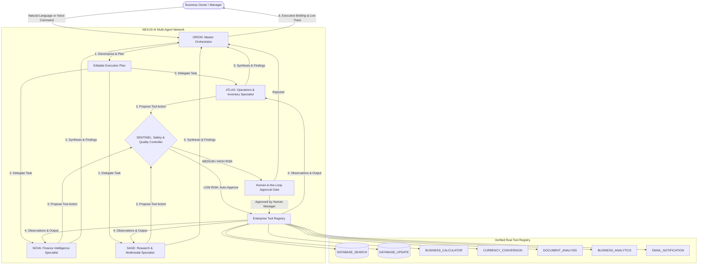

# NEXUS AI — Autonomous Business Operations Platform

> **"One Command. Multiple Agents. Complete Execution."**

NEXUS AI is an enterprise-grade autonomous business operations platform powered by Google Gemini and a cooperating multi-agent intelligence network. Rather than operating as a passive conversational chatbot, NEXUS AI accepts high-level business goals in natural language, formulates structured and editable execution plans, assigns specialist agents to invoke enterprise tools, enforces human-in-the-loop safety gates, and delivers verified outcomes.

---

## 🏛️ Multi-Agent Architecture

NEXUS AI deploys **5 specialized, cooperating AI agents** collaborating under a bounded Plan-Act-Observe-Evaluate-Replan lifecycle:



### The 5 Specialized Agents

1. **ORION — Master Orchestrator (Chief Intelligence Officer)**
   - Decomposes high-level business goals into sequential subtasks.
   - Formulates editable execution plans with dependencies and risk levels.
   - Coordinates handoffs between specialist agents and synthesizes the final executive briefing.

2. **ATLAS — Business Operations Specialist**
   - Audits product inventory and monitors stock against reorder thresholds.
   - Cross-references approved supplier catalogs and lead times.
   - Calculates replenishment units and stages formal purchase orders for human authorization.

3. **NOVA — Finance Intelligence Specialist**
   - Analyzes cash flow, gross margins, and accounts receivable aging.
   - Identifies past-due customer invoices and flags spending anomalies (e.g. freight cost spikes).
   - Never fabricates arithmetic: relies on the deterministic `BUSINESS_CALCULATOR`.

4. **SAGE — Research & Multimodal Intelligence Specialist**
   - Parses unstructured business collateral (PDF invoices, scans, and receipts) using vision intelligence.
   - Extracts structured line items, dates, and totals into an editable form for verification.
   - Formulates strategic business recommendations based on real database metrics.

5. **SENTINEL — Quality, Security & Safety Controller**
   - Independent safety gatekeeper inspecting all agent plans and tool inputs.
   - Classifies risk levels (`LOW`, `MEDIUM`, `HIGH`).
   - Halts execution at `WAITING_APPROVAL` before any consequential state-mutating operation (purchase orders, inventory adjustments, email notifications).
   - Enforces the prominent **STOP EXECUTION** emergency control.

---

## ⚡ Key Capabilities & Themes

- **Autonomous Execution Loop:** Real implementation of `PLAN → ACT → OBSERVE → EVALUATE → REPLAN → VERIFY → COMPLETE`.
- **Native Gemini Function Calling:** Leverages `@google/generative-ai` with structured JSON tool declarations and Zod validation.
- **Human-in-the-Loop Governance:** Actionable Approval Center showing action diffs, business rationale, and risk ratings (`MEDIUM`, `HIGH`).
- **Multimodal Document Intelligence:** Upload PDF/image invoices, review live parsed items, and trigger an automated supplier-audit pipeline.
- **Voice Input (Speech-to-Text):** Integrated Web Speech API with real-time waveform animation and typing fallback.
- **Holistic Business Health Index:** Deterministic 0-100 business health score calculated from profitability, inventory depletion ratio, overdue receivables, and expense spikes.
- **Multi-Tenant Enterprise Isolation:** Role-based access control (`ADMIN`, `MANAGER`, `EMPLOYEE`) with live role switcher in the navbar for testing.
- **Real-Time Streaming:** Server-Sent Events (SSE) stream delivering real-time agent thoughts, step executions, tool calls, and approval events.

---

## 🛠️ Technology Stack

| Layer | Technologies |
|---|---|
| **Frontend** | React 18, TypeScript, Vite 6, Tailwind CSS, React Router 7, Recharts, Lucide Icons |
| **Backend** | Node.js (v26 compatible), Express 4, TypeScript, JWT (`jsonwebtoken`), `bcryptjs`, `multer`, Zod |
| **AI Subsystem** | Google Gemini 1.5 Pro (`@google/generative-ai`) function calling + autonomous deterministic engine |
| **Database** | PostgreSQL (Supabase compatible) + Zero-dependency persistent local storage engine |
| **APIs** | Frankfurter Forex API, Resend Email Gateway (with verified demo sandbox logger) |
| **Testing** | Vitest, Supertest, React Testing Library, JSDOM |
| **API Testing** | Postman Collection v2.1 (`postman/nexus_ai_collection.json`) |

---

## 🚀 Quick Start & Local Execution

### Prerequisites
- Node.js v18+ (tested on Node.js v26.13)
- npm v10+

### 1. Clone & Setup Repository
```bash
git clone https://github.com/your-org/nexus-ai.git
cd nexus-ai
```

### 2. Environment Configuration
The application comes pre-configured with a `.env` file that enables **instant out-of-the-box demo execution** without requiring external credentials:
```bash
cp .env.example backend/.env
```
*(Optional: Provide `GEMINI_API_KEY` or `DATABASE_URL` for live Google Gemini and Supabase cloud connections).*

### 3. Install Dependencies
```bash
# Install backend dependencies
cd backend && npm install

# Install frontend dependencies
cd ../frontend && npm install
```

### 4. Seed Demo Business Data
Populates realistic demo business records (Apex Retail & Distribution Co., products, low-stock alerts, overdue invoices, anomalous expenses, and pre-configured workflows):
```bash
cd backend && npm run seed
```

### 5. Launch Application
In two separate terminals:

```bash
# Terminal 1: Backend Server (Port 5000)
cd backend && npm run dev

# Terminal 2: Frontend Web App (Port 5173)
cd frontend && npm run dev
```

Open your browser to: **`http://localhost:5173`**

---

## 🧪 Running Automated Tests

Run the full automated test suite covering authentication, RBAC, tool validation, agent planning, and human approval gates:

```bash
# Run backend Vitest tests (14 tests)
cd backend && npm test

# Run frontend component tests
cd frontend && npm test
```

---

## 🎬 3–5 Minute Hackathon Demonstration Script

For judges reviewing NEXUS AI, follow this 4-step walkthrough:

### Step 1: Open the AI Command Center
1. Navigate to **AI Command Center** in the left sidebar.
2. Click the suggested command:
   > *"Find products that are running low on stock and prepare a restocking plan."*
3. *(Optional)* Click the microphone icon to test real-time voice speech recognition.

### Step 2: ORION Generates the Execution Plan
1. Click **"Generate Execution Plan"**.
2. Notice ORION decomposes the goal into sequential subtasks:
   - Step 1: ATLAS audits inventory via `DATABASE_SEARCH` (Low Risk)
   - Step 2: ATLAS computes reorder units via `BUSINESS_CALCULATOR` (Low Risk)
   - Step 3: SENTINEL audits purchase order draft (Medium Risk)
   - Step 4: ATLAS generates purchase order in database (Medium Risk)
   - Step 5: ORION synthesizes executive report (Low Risk)

### Step 3: Launch Execution & Trigger Safety Gate
1. Click **"Launch Multi-Agent Execution"**.
2. Watch the real-time execution trace stream via Server-Sent Events.
3. Observe SENTINEL intercept the proposed Purchase Order action and trigger the **Human Approval Gate** (`WAITING_APPROVAL`).
4. Click **"Authorize & Resume"** (or view the pending item in the **Approval Center**).
5. Watch the agent immediately resume, finalize the purchase order, and present the final executive briefing.

### Step 4: Multimodal Document Intelligence
1. Navigate to **Document Intelligence** in the sidebar.
2. Upload any invoice PDF or receipt image (or select the sample invoice).
3. Watch SAGE extract line items, vendor name, and tax into an editable form.
4. Click **"Trigger Multi-Agent Registration"** to execute the intake pipeline!

---

## 🔐 Security & Governance Protections

- **Server-Side Authorization & RBAC:** Enforces user permission boundaries on every API route; UI role switching strictly reflects backend-enforced JWT claims.
- **Untrusted Document Boundary:** Uploaded documents are treated as data payloads, never as system instructions (prompt-injection defense).
- **Audit Logging:** Every database mutation, tool run, and human decision is recorded to an immutable ledger (`audit_logs`).
- **Emergency Stop Control:** The `STOP EXECUTION` control cancels pending agent turns, prevents orphaned operations, and records the event.

---

## 📄 License & Team
Developed for the National AI Agents Hackathon by the **NEXUS AI Engineering Team**. Licensed under MIT.
